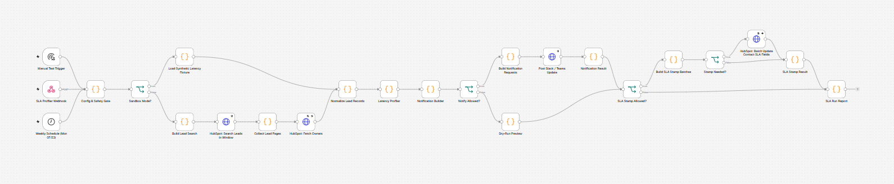
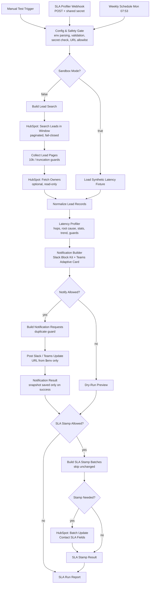

# n8n-hubspot-sla-breach-root-cause-latency-profiler

**Speed-to-lead SLA profiler for HubSpot, built in n8n.** It splits every lead's journey from form submit to first dial into hops, measures each hop against its own budget, finds where breaches actually come from, and posts a root-cause brief to a leadership Slack or Microsoft Teams channel.

```
form submit ──► webhook ingest ──► enrichment ──► owner assignment ──► first dial
     │   2 min budget  │  5 min budget │  5 min budget   │  15 min budget  │
     └──────────────────────────── 30 min total SLA ──────────────────────┘
```

A total "time to first touch" number tells you that leads wait. It doesn't tell you *why*. This workflow attributes every breach to the hop that overran its budget the most. A slow enrichment vendor, a routing rule that leaves leads unassigned, a webhook queue that backs up, and reps who don't dial each show up as a separate, ranked root cause, with p50/p90 per hop, a bottleneck call-out, a list of open breaches still waiting right now, and a week-over-week trend.

> **Safe by default.** Out of the box the workflow runs in `SANDBOX_MODE=true` against a synthetic fixture and makes **zero** API calls. It posts nothing and writes nothing to HubSpot until you opt in explicitly, one switch at a time.

---

## Contents

- [What it does](#what-it-does)
- [Architecture](#architecture)
- [Prerequisites](#prerequisites)
- [Quick start (sandbox, 2 minutes)](#quick-start-sandbox-2-minutes)
- [Going live in stages](#going-live-in-stages)
- [Environment variables](#environment-variables)
- [Latency calculation logic](#latency-calculation-logic)
- [Notification format](#notification-format)
- [Safety model](#safety-model)
- [Compliance checklist](#compliance-checklist)
- [Offline simulator](#offline-simulator)
- [Troubleshooting](#troubleshooting)
- [Repository layout](#repository-layout)
- [Disclaimer](#️-disclaimer--liability-limitation)

---

## What it does

| Capability | Detail |
|---|---|
| Hop decomposition | Five stage timestamps → four hops, each with its own budget (`HOP_SLA_*_MINUTES`) plus a total SLA (`TOTAL_SLA_MINUTES`). |
| Root-cause attribution | Every breached lead gets one root cause: the hop with the largest overrun. Open leads that are still waiting get a "stalled" cause for the hop they're stuck in. |
| Bottleneck detection | The hop that causes the most breaches (tie → largest total overrun) is called out. |
| Per-hop distributions | n, p50, p90, p95, max, mean, % over budget, plus open leads already over budget. |
| SLA adherence | Met ÷ decided leads (met + breached + open-breached). In-flight leads that are still within SLA are excluded so they don't distort the rate. |
| Wall or business clock | `SLA_CLOCK=business` counts only business hours on business days, skipping holidays, at a fixed UTC offset. |
| Open-breach watchlist | Leads breaching *right now*, oldest first, linked to the HubSpot record by ID only (no names or emails). |
| Owner and source views | First-dial p50 and dial-side breaches per owner; adherence per lead source. |
| Week-over-week trend | Adherence, breach count, p90 and top root cause against the last *successfully posted* run. |
| Data-quality guards | Invalid, future or out-of-order timestamps become anomalies; posting is blocked if they exceed `MAX_ANOMALY_PCT`. |
| Optional CRM stamp | Writes `sla_status`, `sla_root_cause`, `sla_speed_to_lead_minutes` and `sla_analyzed_at` to contacts so you can build HubSpot reports and lists. Unchanged values are skipped. |

### Root-cause categories

| Code | Meaning |
|---|---|
| `INGEST_DELAY` | Form submit → webhook ingest overran its budget. |
| `ENRICHMENT_DELAY` | Ingest → enrichment overran (slow vendor, queue, retries). |
| `ASSIGNMENT_DELAY` | Enrichment → owner assignment overran (routing rules, round-robin gaps). |
| `FIRST_DIAL_DELAY` | Assignment → first dial overran (rep capacity, after-hours, notification gaps). |
| `INGEST_STALLED` / `ENRICHMENT_STALLED` | Open lead stuck before ingest or enrichment completed. |
| `UNASSIGNED_BOTTLENECK` | Open lead with no owner assigned, already over SLA. |
| `MISSED_FIRST_DIAL` | Open lead assigned but never dialled, already over SLA. |
| `CUMULATIVE_DRIFT` | Every hop stayed within budget, but together they exceeded the total SLA. |
| `DATA_ANOMALY` | Timestamps can't be trusted (see [anomalies](#anomalies-fail-safe-not-fail-silent)). |

---

## Architecture





25 nodes: 3 triggers, 1 sticky note, 12 Code nodes, 4 IF nodes and 4 HTTP Request nodes. There is exactly **one** CRM write node (the contact batch update), and it sits behind three independent gates.

---

## Prerequisites

- **n8n** 1.x or later (tested on n8n 2.47.7, self-hosted). It uses only core nodes; no community nodes are required.
- `N8N_BLOCK_ENV_ACCESS_IN_NODE=false` so that `{{ $env.X }}` resolves. If env access is blocked, the workflow detects it and stays in sandbox mode.
- **HubSpot private app** (only for live mode) with these scopes:

| Scope | Needed for | Required? |
|---|---|---|
| `crm.objects.contacts.read` | Contact search of the window | Yes |
| `crm.objects.owners.read` | Owner names in the owner view | Optional (falls back to `Owner <id>`) |
| `crm.objects.contacts.write` | SLA stamp properties | Only if `HUBSPOT_MUTATIONS_ENABLED=true` |

- **Stage timestamps on contacts.** The defaults are:

| Hop stage | Default property | Type | Notes |
|---|---|---|---|
| Form submit | `first_conversion_date` | HubSpot built-in | Date the contact first submitted a form. Use `recent_conversion_date` if re-conversions should restart the clock. |
| Webhook ingest | `lead_ingested_at` | **Custom** date-time | Written by your ingest pipeline or middleware when it receives the lead. |
| Enrichment | `lead_enriched_at` | **Custom** date-time | Written by your enrichment step. Optional: see `ENRICHMENT_OPTIONAL`. |
| Owner assignment | `hubspot_owner_assigneddate` | HubSpot built-in | Owner assigned date. |
| First dial | `hs_sa_first_engagement_date` | HubSpot built-in | Date the current owner first engaged the contact. See the caveat below. |

> **First-dial caveat.** HubSpot's first-engagement date counts the owner's first outreach of any kind, emails included, and it relates to the *current* owner, so it can change when a contact is reassigned. For a strict "first dial" SLA, have your dialer (or a workflow on the first logged call) write a dedicated date-time property and point `FIRST_DIAL_PROPERTY` at it.

- **Optional custom contact properties** for the stamp: `sla_status` (single-line text or dropdown), `sla_root_cause` (single-line text or dropdown), `sla_speed_to_lead_minutes` (number) and `sla_analyzed_at` (date-time or text). Create them before you enable mutations.
- A **Slack incoming webhook** and/or a **Microsoft Teams Workflows webhook** ("Post to a channel when a webhook request is received") for a *private* leadership channel. Office 365 connectors are retired; the payload here targets the Workflows trigger.

---

## Quick start (sandbox, 2 minutes)

```bash
# 1. Run the offline simulator. Zero dependencies, zero network.
node scripts/simulate-sandbox-run.js
#    → 116 checks; message previews written to sim-output/

# 2. Import into n8n
#    Workflows → Import from File → workflow.json  (arrives inactive)

# 3. Click "Test workflow" on the Manual Test Trigger.
#    The run uses sample-payloads/latency-fixture.json (20 synthetic leads)
#    and ends at "SLA Run Report" with status DRY_RUN.
```

Open **Dry-Run Preview** to see the exact Slack blocks and Teams card that *would* be posted. Set `NOW_OVERRIDE=2026-11-16T10:00:00Z` to reproduce the fixture's numbers exactly: 46.7% adherence, bottleneck at *assign → first dial*.

---

## Going live in stages

Each stage turns on **one** capability. Stay at each stage until you've reviewed the output.

| Stage | Set | Result |
|---|---|---|
| 0. Sandbox | *(nothing)* | Synthetic fixture, zero API calls. |
| 1. Read-only live | `SANDBOX_MODE=false`, `HUBSPOT_ACCESS_TOKEN`, `HUBSPOT_PORTAL_ID` | Real contacts are searched and analysed. Nothing is posted or written. Review the **Dry-Run Preview**. |
| 2. Tune | `HOP_SLA_*`, `TOTAL_SLA_MINUTES`, `SLA_CLOCK`, business hours, property names | Re-run until the hop numbers match what your team sees. |
| 3. Post to a test channel | `DRY_RUN=false`, `NOTIFICATIONS_ENABLED=true`, `NOTIFY_CHANNELS`, the webhook URL(s) for a **private test channel** | Brief posted once per as-of minute. |
| 4. Stamp contacts (optional) | `HUBSPOT_MUTATIONS_ENABLED=true` (with `DRY_RUN=false`) | SLA fields are written to analysed contacts. Test in a HubSpot sandbox first. |
| 5. Schedule | Point the webhook URL at the leadership channel; activate the workflow | Runs Mondays at 07:53 (n8n timezone), or on a webhook call. |

### Sample `.env` for stage 3

```bash
SANDBOX_MODE=false
DRY_RUN=false
NOTIFICATIONS_ENABLED=true
HUBSPOT_MUTATIONS_ENABLED=false
HUBSPOT_ACCESS_TOKEN=            # from your secret manager
HUBSPOT_PORTAL_ID=99000001       # placeholder: your numeric portal ID
NOTIFY_CHANNELS=slack
SLACK_WEBHOOK_URL=               # from your secret manager
TOTAL_SLA_MINUTES=30
SLA_CLOCK=business
BUSINESS_HOURS=09:00-18:00
SLA_UTC_OFFSET_MINUTES=-300
```

### Webhook trigger

```bash
curl -X POST "https://<your-n8n-host>/webhook/hubspot-sla-latency" \
  -H "Content-Type: application/json" \
  -H "x-sla-secret: $WEBHOOK_SHARED_SECRET" \
  -d '{"window_hours": 24, "as_of": "2026-11-16T10:00:00Z"}'
```

In live mode the secret is required and compared in constant time. Secret headers and the query string are stripped before any data moves past the Config node. `window_hours` must be between 1 and 2160. `as_of` must be an ISO-8601 UTC timestamp and can't be in the future.

---

## Environment variables

All values are read only from `$env`. The complete template, with safe defaults, is in [.env.example](.env.example).

### Safety switches

| Variable | Default | Turns on when | Effect |
|---|---|---|---|
| `SANDBOX_MODE` | `true` | *off* only on `false/0/no/off` | Synthetic fixture, no API calls |
| `DRY_RUN` | `true` | *off* only on `false/0/no/off` | No posts, no writes; preview only |
| `NOTIFICATIONS_ENABLED` | `false` | `true/1/yes/on` | Allows Slack/Teams posts |
| `HUBSPOT_MUTATIONS_ENABLED` | `false` | `true/1/yes/on` | Allows the SLA stamp batch update |
| `FORCE_REPOST` | `false` | `true/1/yes/on` | Re-posts a window that was already posted |

A typo (for example `SANDBOX_MODE=flase`) keeps the safe value.

### Window and SLA

| Variable | Default | Notes |
|---|---|---|
| `WINDOW_HOURS` | `168` | 1–2160. Leads submitted in `[AS_OF − WINDOW_HOURS, AS_OF)`. |
| `AS_OF` | now | ISO UTC, floored to the minute. A future value is refused. |
| `TOTAL_SLA_MINUTES` | `30` | End-to-end submit → first dial. |
| `HOP_SLA_INGEST_MINUTES` | `2` | Submit → ingest budget. |
| `HOP_SLA_ENRICH_MINUTES` | `5` | Ingest → enrichment budget. |
| `HOP_SLA_ASSIGN_MINUTES` | `5` | Enrichment → assignment budget. |
| `HOP_SLA_FIRST_DIAL_MINUTES` | `15` | Assignment → first dial budget. |
| `SLA_CLOCK` | `wall` | `wall` (24/7) or `business`. |
| `BUSINESS_HOURS` | `09:00-18:00` | Open–close, local time. |
| `BUSINESS_DAYS` | `1,2,3,4,5` | 0 = Sunday … 6 = Saturday. |
| `BUSINESS_HOLIDAYS` | *(empty)* | Comma-separated `YYYY-MM-DD`. |
| `SLA_UTC_OFFSET_MINUTES` | `0` | −840…840. A fixed offset: **daylight saving time is not applied**, so update it at DST changes or run in UTC. |
| `CLOCK_SKEW_TOLERANCE_SECONDS` | `60` | Out-of-order stamps within this tolerance become a 0 s hop flagged `CLOCK_SKEW`. |
| `ENRICHMENT_OPTIONAL` | `true` | `true`: a lead past ingest but not enriched counts as waiting for assignment. |
| `LIFECYCLE_STAGES` | *(all)* | e.g. `lead,marketingqualifiedlead`. |

### Properties

| Variable | Default |
|---|---|
| `FORM_SUBMIT_PROPERTY` | `first_conversion_date` |
| `INGEST_TIMESTAMP_PROPERTY` | `lead_ingested_at` |
| `ENRICHMENT_TIMESTAMP_PROPERTY` | `lead_enriched_at` |
| `OWNER_ASSIGNED_PROPERTY` | `hubspot_owner_assigneddate` |
| `FIRST_DIAL_PROPERTY` | `hs_sa_first_engagement_date` |
| `LEAD_SOURCE_PROPERTY` | `hs_analytics_source` |
| `STAMP_STATUS_PROPERTY` | `sla_status` |
| `STAMP_ROOT_CAUSE_PROPERTY` | `sla_root_cause` |
| `STAMP_SPEED_TO_LEAD_PROPERTY` | `sla_speed_to_lead_minutes` |
| `STAMP_ANALYZED_AT_PROPERTY` | `sla_analyzed_at` |

### Guards, HubSpot, notifications

| Variable | Default | Notes |
|---|---|---|
| `MAX_ANOMALY_PCT` | `20` | Posting is blocked above this anomaly rate. |
| `MIN_LEADS_TO_POST` | `1` | Minimum analysable leads before posting. |
| `HUBSPOT_ACCESS_TOKEN` | — | Private-app token. Required in live mode. |
| `HUBSPOT_PORTAL_ID` | `99000001` | Numeric. Used for record links. |
| `HUBSPOT_API_BASE_URL` | `https://api.hubapi.com` | |
| `HUBSPOT_APP_BASE_URL` | `https://app.hubspot.com` | EU portals: `https://app-eu1.hubspot.com`. |
| `HUBSPOT_SEARCH_PAGE_SIZE` | `200` | 1–200. |
| `NOTIFY_CHANNELS` | `slack` | `slack`, `teams` or `slack,teams`. |
| `SLACK_WEBHOOK_URL` / `TEAMS_WEBHOOK_URL` | — | Secrets. Read only inside the HTTP node. |
| `NOTIFY_ALLOWED_HOST_SUFFIXES` | `hooks.slack.com,.logic.azure.com,.powerplatform.com,.powerautomate.com` | https only; URLs with userinfo are refused. |
| `REP_LABEL` | `name` | `id` keeps owner names out of messages. |
| `MAX_OPEN_BREACHES_LISTED` / `MAX_OWNERS_LISTED` | `5` / `5` | |
| `REPORT_TITLE` | `Speed-to-Lead SLA: Breach Root Cause` | |
| `WEBHOOK_SHARED_SECRET` | — | 16+ characters; required for live webhook runs. |
| `NOW_OVERRIDE` | — | Pins "now" for reproducible tests. |

---

## Latency calculation logic

### 1. Window and search

The contact search filters on `FORM_SUBMIT_PROPERTY >= windowStart AND < AS_OF` (epoch-ms values), optionally `lifecyclestage IN (...)`, sorted by `hs_object_id`, at up to 200 per page. It requests **only** timing, owner, source, lifecycle and stamp properties. No name, email, phone or company is ever fetched.

Pagination is **fail-closed**. The run stops, and nothing is posted, if any page errors, if HubSpot reports 10,000 or more matches (the search API's ceiling), or if pagination stops before the reported total (50-page safety cap). A partial report could understate breaches, so the workflow refuses to produce one.

### 2. Per-lead hops

Each timestamp is parsed (ISO-8601 or epoch ms; anything outside 2000–2100 is invalid). For each lead:

1. **Missing intermediate stages merge.** If enrichment is blank but assignment exists, the lead gets one `enrich+assign` segment whose budget is the sum of both hop budgets, flagged `ENRICH_MISSING`. Merged segments are excluded from per-hop distributions so they don't distort them.
2. **Open leads get a running segment.** A lead with no first dial yet is measured up to `AS_OF` against the hop it's waiting in:
   - no ingest → `INGEST_STALLED`
   - no enrichment (when it's mandatory) → `ENRICHMENT_STALLED`
   - no owner → `UNASSIGNED_BOTTLENECK`
   - owner but no dial → `MISSED_FIRST_DIAL`
3. **Clock.** Wall-clock seconds, or business seconds: each local day is walked at `SLA_UTC_OFFSET_MINUTES`, counting only the overlap with `BUSINESS_HOURS` on `BUSINESS_DAYS` that aren't holidays.

### 3. Status

| Status | Rule |
|---|---|
| `MET` | Dialled, total ≤ `TOTAL_SLA_MINUTES`. |
| `BREACHED` | Dialled, total > SLA. |
| `OPEN_WITHIN_SLA` | Not yet dialled, still inside the SLA. Excluded from adherence. |
| `OPEN_BREACHED` | Not yet dialled, already past the SLA. Counted as a breach. |
| `DATA_ANOMALY` | Timestamps unusable. Excluded from all statistics. |

**Adherence** = MET ÷ (MET + BREACHED + OPEN_BREACHED).

### 4. Root cause

For a breached lead, overrun = `segment seconds − segment budget` for each segment. The root cause is the category of the segment with the **largest positive overrun** (tie → the earlier hop). If no segment overran its own budget, the cause is `CUMULATIVE_DRIFT`. Any hop over budget on a lead that still MET the total is flagged `HOP_OVER_BUDGET`, so leadership can see near-misses.

The **bottleneck** is the hop whose root causes account for the most breaches (completed and open together). Ties go to the larger total overrun.

### 5. Statistics

Percentiles use the nearest-rank method (p = value at rank ⌈q·n⌉) on completed segments. The simulator cross-checks these against an independent reference calculation.

### Anomalies: fail-safe, not fail-silent

| Code | Trigger |
|---|---|
| `MISSING_SUBMIT_TIMESTAMP` | No form-submit timestamp. |
| `INVALID_TIMESTAMP` | Unparseable or out-of-range value. |
| `FUTURE_TIMESTAMP` | A stage after `AS_OF`. |
| `NON_MONOTONIC_TIMESTAMPS` | A later stage earlier than the previous one by more than `CLOCK_SKEW_TOLERANCE_SECONDS`. |

Anomalies are listed in the message, and the guard blocks posting when they exceed `MAX_ANOMALY_PCT` of in-window leads. A lead whose submit time is outside the window is ignored before anomaly checks, so it can't inflate the rate.

---

## Notification format

Built from the bundled fixture (`sim-output/text-preview.txt`):

```
Speed-to-Lead SLA: Breach Root Cause [SANDBOX]
2026-11-09 10:00 → 2026-11-16 10:00 UTC (168 h) · SLA 30.0m submit → first dial · wall clock
Adherence 46.7%; breaches 6 closed + 2 open; p50/p90 12.5m/2h 02m
Bottleneck: Owner assignment → first dial drives 3 of 8 breaches (37.5%), 2d 8h total overrun.
Hop                   p50     p90     budget  over
submit -> ingest      20s     1.0m    2.0m    6.3%
ingest -> enrich      1.0m    22.0m   5.0m    13.3%
enrich -> assign      1.0m    2.0m    5.0m    7.7% (+1 open)
assign -> first dial  9.0m    2h 00m  15.0m   15.4% (+1 open)
TOTAL submit -> dial  12.5m   2h 02m  30.0m
1. Enrichment delay: 2 (25.0%)
2. Late first dial: 2 (25.0%)
...
```

- **Slack:** Block Kit (header, KPI fields, trend, bottleneck, monospace hop table, ranked root causes, open-breach links, owner view, source adherence, data quality). It stays under 50 blocks, with `unfurl_links: false`. CRM text is escaped so `<!channel>`, mentions and markdown injected through owner names are neutralised.
- **Teams:** Adaptive Card 1.4 wrapped in a Workflows `message` envelope, trimmed to stay under the 28 KB limit.
- Leads are referenced by **HubSpot record ID and link only**.

---

## Safety model

| Layer | Mechanism |
|---|---|
| Defaults | Sandbox and dry-run on; notifications and mutations off. Typos keep the safe value. A blocked `$env` means sandbox. |
| Credentials | `Authorization: Bearer {{ $env.HUBSPOT_ACCESS_TOKEN }}` in headers; webhook URLs read only inside the HTTP node expression. No n8n credentials are stored in the JSON, and secrets never enter item data. |
| URL allowlist | Notification hosts must match `NOTIFY_ALLOWED_HOST_SUFFIXES`, https only, with no userinfo. |
| Webhook | Constant-time shared-secret check; secret headers and query string stripped. |
| Read path | Fail-closed pagination: any page error, ≥10,000 matches or truncation aborts the run. |
| Data minimisation | The search requests no PII properties; messages carry record IDs only; `REP_LABEL=id` removes owner names. |
| Guards | Anomaly-rate and minimum-sample guards block posting. Config errors block posting and stamping. |
| Idempotency | Duplicate-post guard per as-of minute (`FORCE_REPOST` to override). The snapshot is saved only after every channel succeeded, so a failed post never corrupts the trend. |
| Write path | One batch-update node, only `sla_*` properties, unchanged values skipped, chunks of 100, with errors reported in the run report. |
| Retries | HubSpot reads and writes retry; Slack/Teams posts **don't**, to avoid duplicate messages. |

---

## Compliance checklist

- [ ] Lawful basis documented for processing lead timing and owner performance data (GDPR Art. 6 / CCPA notice).
- [ ] Works council, union or HR sign-off where owner-level metrics are reported (some jurisdictions require it).
- [ ] The notification channel is **private** and limited to people entitled to the data.
- [ ] Webhook URLs and tokens are stored in a secret manager and rotated if exposed.
- [ ] HubSpot private-app scopes are the minimum needed (read-only unless stamping).
- [ ] Retention for n8n execution data is configured (`EXECUTIONS_DATA_PRUNE`, `EXECUTIONS_DATA_MAX_AGE`).
- [ ] The first-dial property semantics are agreed (any engagement vs. dial only).
- [ ] Business hours, holidays and UTC offset match the SLA you promise.
- [ ] Root-cause output is reviewed by a person before any individual is held accountable.

---

## Offline simulator

```bash
node scripts/simulate-sandbox-run.js          # verbose
node scripts/simulate-sandbox-run.js --quiet  # summary only
```

Zero dependencies (Node ≥ 18, using only `fs`, `path` and `vm`). It executes `workflow.json` itself: it follows connections, runs every Code node in a VM, evaluates expressions, and emulates pagination, static data and HTTP calls against in-memory HubSpot/Slack/Teams mocks. Its **116 checks** cover:

1. Structure and static safety (credentials, writers, secrets, emails, expressions compile).
2. Safe defaults and config validation (typos, blocked env, as-of, business hours, URL allowlist).
3. Live refusals and webhook authentication.
4. Fixture parity and data minimisation.
5. Timestamp parsing and wall/business/holiday/offset clocks.
6. Sandbox end-to-end: every lead's status and root cause, percentiles against a reference, and payload limits.
7. Policy variations (business clock, budgets, skew, window, guards, `REP_LABEL`).
8. Live HubSpot paths with mocks (search body, read-only, pagination of 450 leads, fail-closed cases).
9. Armed runs: posting, duplicate guard, `FORCE_REPOST`, trend, post failure, stamps, dry-run override, hostile-name escaping.

Message previews and run reports are written to `sim-output/` (git-ignored).

### The synthetic fixture

`sample-payloads/latency-fixture.json` holds 20 fictitious leads (IDs `9900600xx`, portal `99000001`) and four mock owners at `@example.com`. The scenarios are documented in its `_meta.scenarios`: fast routing, slow enrichment, a webhook ingest delay, a routing delay, an unassigned bottleneck, a missed first dial, a weekend lead (breached on the wall clock, met on the business clock), missing enrichment, clock skew, non-monotonic and invalid timestamps, a missing submit, and an out-of-window lead.

---

## Troubleshooting

| Symptom | Cause / fix |
|---|---|
| Always `DRY_RUN`, even with flags set | `$env` is blocked (`N8N_BLOCK_ENV_ACCESS_IN_NODE`), or a flag has a typo. Check `safetyDecisions` in the Config node output. |
| `Live mode requires HUBSPOT_ACCESS_TOKEN` | Set the token, or go back to `SANDBOX_MODE=true`. |
| `HubSpot reports N ≥ 10,000 matches` | Narrow `WINDOW_HOURS` or add `LIFECYCLE_STAGES`. The search API can't page past 10,000. |
| `pagination stopped before total` | A page was lost or the 50-page cap was hit. Re-run with a smaller window. |
| Every lead is `OPEN_*` | `FIRST_DIAL_PROPERTY` is wrong, empty, or not returned by the search. Check the internal name. |
| Lots of `NON_MONOTONIC_TIMESTAMPS` | Systems write in different time zones or with clock drift. Fix the writers, or raise `CLOCK_SKEW_TOLERANCE_SECONDS` carefully. |
| Posting blocked: anomaly rate | Above `MAX_ANOMALY_PCT`. Fix the data before reporting on it. |
| Owners show as `Owner 123` | `crm.objects.owners.read` scope is missing (non-fatal), or `REP_LABEL=id`. |
| Slack 404 / Teams 400 | Webhook revoked, or the Teams URL isn't a Workflows trigger. |
| `SKIPPED_ALREADY_POSTED` | That as-of minute was already posted. Use `FORCE_REPOST=true` if you mean it. |
| Business-clock numbers are off by an hour | DST: `SLA_UTC_OFFSET_MINUTES` is fixed; update it at DST changes. |
| Stamp errors 400 | The `sla_*` properties don't exist, or have the wrong type. |

---

## Repository layout

```
n8n-hubspot-sla-breach-root-cause-latency-profiler/
├── workflow.json                     # n8n workflow (25 nodes, inactive on import)
├── README.md                         # this file
├── DISCLAIMER.md                     # liability limitation
├── LICENSE                           # MIT
├── .env.example                      # every variable, safe defaults
├── .gitignore
├── sample-payloads/
│   └── latency-fixture.json          # 20 synthetic leads, 4 mock owners
└── scripts/
    └── simulate-sandbox-run.js       # zero-dependency offline simulator (116 checks)
```

---

## ⚠️ Disclaimer & Liability Limitation

**Use at your own risk.** The code, workflows, and scripts in this repository are provided for educational and architectural demonstration purposes.

**No Liability:** The author and dhRobin Systems accept no responsibility or liability for any direct, indirect, incidental, or consequential damages that result from using, misusing, or deploying these scripts. That includes inaccurate or late SLA reports, wrongly attributed root causes, operational or staffing decisions based on automated latency analysis, lead or timing data disclosed to the wrong audience, and incorrectly written HubSpot records.

**No Warranty:** All software, n8n JSON blueprints, JavaScript modules and sample payloads are provided "AS IS", without warranty of any kind, express or implied, including warranties of merchantability, fitness for a particular purpose and non-infringement. Latency figures are only as accurate as the timestamps your systems write to HubSpot.

**Production Testing Required:** Always test thoroughly in an isolated staging environment, such as a HubSpot developer test account or sandbox and a private test Slack or Teams channel, with `SANDBOX_MODE=true` and `DRY_RUN=true` enabled, before you connect live credentials or enable notifications or mutations.

**Third-Party APIs & Compliance:** You alone are responsible for complying with the terms of service, rate limits, data privacy regulations (GDPR/CCPA), employment rules and security policies of HubSpot, Slack, Microsoft, n8n and any connected services. That includes limiting owner-level metrics to the audience entitled to see them and reviewing every automatically posted message and updated record.

The full disclaimer is also available in [DISCLAIMER.md](DISCLAIMER.md).

## License

Released under the MIT License. Copyright (c) 2026 DH Robin (dhRobin Systems). See [LICENSE](LICENSE).

---

Full text: DISCLAIMER.md · Licensed under the MIT License. License: MIT © 2026 DH Robin (dhRobin Systems) · Provided as-is, see the disclaimer.
